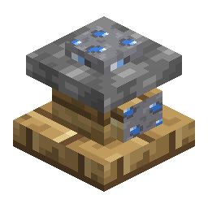
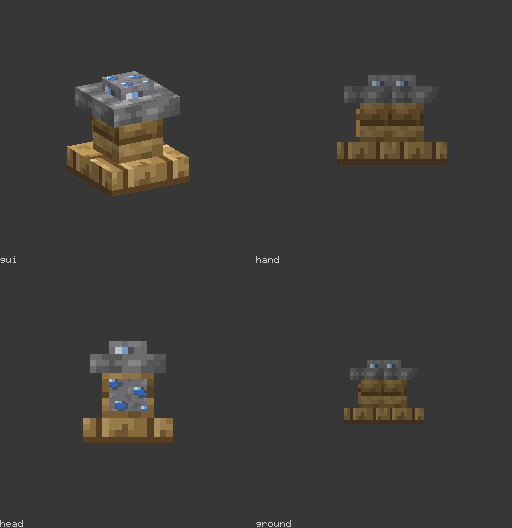
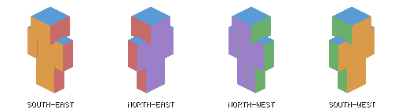
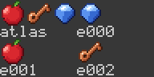

# Showcase assets — how they were made

Every file in this directory was produced by **mc-asset itself**.
No external image tools were used. All procedural sources use fixed seeds, so
the full set below is reproducible end to end. The showcase sources are
chosen so each effect stays visible at README display size:
high-detail noise for pixelize, a 64-band gradient for quantize, and a
hand-built brick block for tiling.

The hand-drawn sprites (items, tiling blocks, animation frames, and
GUI frames) follow the vanilla style rules in the repository's
`minecraft-pixel-art` skill (`skills/minecraft-pixel-art/`): 16×16, light
from the top left, outlines in each material's own dark shades, 8–12 opaque
colors per item, dark seams on the bottom and right of block elements, and
original designs rather than traces of vanilla textures.

Conventions used in the commands: `OUT=docs/assets/showcase`,
`SCRATCH=/tmp/showcase` (throwaway intermediates only; nothing is read from
outside mc-asset). All upscales are nearest-neighbor (`transform
--resize-mode nearest` or `preview --scale`) to keep pixels crisp, and every
final PNG is passed through `mc-asset optimize`.

## File list

| File | Size (px) | Purpose |
| --- | --- | --- |
| `pixelize-before.png` | 256×256 | Clustered-noise reference, ×2 nearest upscale (the "before") |
| `pixelize-after.png` | 256×256 | Same reference run through `pixelize` to 16px, then ×16 nearest (the "after") |
| `quantize-source.grid` | 64×64 ASCII grid | Hand-built source: 64 horizontal bands, deep blue → purple → warm gold |
| `quantize-before.png` | 256×256 | The 64-band gradient, ×4 nearest upscale (the "before") |
| `quantize-after.png` | 256×256 | Same gradient through `quantize --colors 8`, then ×4 (the "after") |
| `tile-source.grid` | 16×16 ASCII grid | Hand-authored sandstone-style brick block face: the tile source |
| `tile-pattern.png` | 128×128 | The 16px block, ×8 nearest |
| `tile-preview.png` | 256×256 | 4×4 repeat of the 16px block (64px wall, ×4 nearest) |
| `anim/frame-1.grid` … `anim/frame-4.grid` | 16×16 ASCII grids | Hand-authored glowing-ore frames |
| `anim-sheet.png` | 64×256 | The four frames packed vertically (16×64 sheet), ×4 nearest |
| `items/*.grid` | 16×16 ASCII grids | Hand-authored sword, pickaxe, apple, potion, sapphire, key |
| `items.png` | 576×96 | The six items packed into one horizontal strip (96×16), ×6 nearest |
| `variants.png` | 720×80 | `items/sword.grid` recolored into all nine builtin materials, packed into a strip (144×16), ×5 nearest |
| `patterns/<pattern>.png` | 64×64 each | One 16px `generate` swatch per pattern, ×4 nearest |
| `quickstart-gem.png` | 128×128 | The README Quickstart gem (the sapphire without palette roles), ×8 nearest |
| `batch-edit-gem.png` | 128×128 | The same gem after the README Recipe 7 batch, ×8 nearest |
| `gui/dialog.grid` / `gui/dialog.png.mcmeta` | 16×16 ASCII grid + mcmeta | Hand-authored vanilla-style GUI frame with a 4px `nine_slice` border |
| `gui/dialog.png` | 64×64 | The frame, ×4 nearest |
| `gui/nine-slice.png` / `gui/stretch.png` | 192×128 each | `gui-scale` to 48×32 with and without the mcmeta, ×4 nearest |
| `blocks/<stone,dirt,planks>.grid` | 16×16 ASCII grids | Hand-authored stone, dirt, and oak-planks block faces: tile sources |
| `blocks.png` | 384×128 | The three block faces packed into one horizontal strip (48×16), ×8 nearest |
| `blocks-wall.png` | 256×256 | 4×4 repeat of the planks face (64px wall, ×4 nearest) |
| `potion-variants.png` | 240×80 | `items/potion.grid` recolored into crystal, gold, and iron, packed into a strip (48×16), ×5 nearest |
| `compare-diff.png` | 128×128 | `compare` of the iron and gold potion variants (16×16 diagnostic), ×8 nearest |
| `gui/button.grid` / `gui/button.png.mcmeta` | 16×16 ASCII grid + mcmeta | Hand-authored vanilla-style button with a 3px `nine_slice` border |
| `gui/button.png` | 64×64 | The button, ×4 nearest |
| `gui/button-nine-slice.png` / `gui/button-stretch.png` | 192×64 each | `gui-scale` to 48×16 with and without the mcmeta, ×4 nearest |
| `model-shrine.json` | Java model spec | Five-cuboid stepped shrine block referencing `bricks`, `planks`, `stone`, and `ore` |
| `model-preview.png` | 384×128 | Three-view diagnostic PNG (`front`, `right`, `top`, `--size 128`) from `model preview` |
| `advanced/isometric.png` | 256×256 | Lit isometric view of the shrine |
| `advanced/display.png` | 512×528 | Four display poses of the shrine |
| `advanced/entity.png` | 512×140 | Four views of a generated player UV template |
| `advanced/font-icons.png` | 192×96 | Bitmap font atlas and labeled icons |
| `advanced/model-display.json`, `advanced/font-icons.json`, `advanced/e000.png` … `e002.png` | Model, font spec, and icons | Inputs for the advanced previews |

## 1. Pixelize before / after

Base: `clustered-noise`, 128px, seed 7, palette `crystal` — a high-detail
swatch whose finest cells are 4px wide. The before is a ×2 nearest upscale;
the after goes through `pixelize` (preset `block`) down to 16px and back up
×16, so the 4px clusters merge into visibly coarser blocks. Size 32 was
tried first and dropped: 128/32 = 4 aligns with the 4px cells, so
the round trip came back byte-identical to the before.

```sh
mc-asset generate clustered-noise --size 128 --seed 7 --palette crystal \
  --output $SCRATCH/px-base.png --source $SCRATCH/px-base.mcpx
mc-asset transform $SCRATCH/px-base.png --resize 256x256 --resize-mode nearest \
  --output $OUT/pixelize-before.png
mc-asset pixelize $SCRATCH/px-base.png --size 16 --preset block \
  --output $SCRATCH/px-16.png
mc-asset transform $SCRATCH/px-16.png --resize 256x256 --resize-mode nearest \
  --output $OUT/pixelize-after.png
```

## 2. Quantize before / after

Source: `quantize-source.grid`, a 64×64 `[grid tokens]` grid with one solid
color per row — 64 bands interpolating deep blue `#16245E` → purple
(mid-range) → warm gold `#F5C04A` in piecewise-linear RGB.
Single-character symbols cap at 63, so the grid uses tokenized `c00`…`c63`
symbols. Rendered with `render` to 64×64, then ×4 nearest for display; the
after passes through `quantize --colors 8` first, collapsing the 64 bands
into 8.

```sh
mc-asset render $OUT/quantize-source.grid \
  --output $SCRATCH/q64.png --source $SCRATCH/q64.mcpx
mc-asset transform $SCRATCH/q64.png --resize 256x256 --resize-mode nearest \
  --output $OUT/quantize-before.png
mc-asset quantize $SCRATCH/q64.png --colors 8 --output $SCRATCH/q8.png
mc-asset transform $SCRATCH/q8.png --resize 256x256 --resize-mode nearest \
  --output $OUT/quantize-after.png
```

## 3. Material variants

Source: `items/sword.grid` (section 6). Its palette tags every color with a
role. The blade and guard use `dark` (the lit-edge outline), `shadow`, `base`,
and `highlight`, which `variant` maps onto the target ramp; the darkest outline
(`outline`), the white glint (`accent`), and the wooden grip and guard gem
(`custom`) are kept verbatim. The sword is recolored into all nine builtin
materials and the variants are packed into one strip with `animate pack`,
which reads the `.mcpx` files in name order (copper, crystal, diamond, gold,
iron, netherite, oxidized_copper, stone, wood) and skips the PNGs with a
`NON_MCPX_IGNORED` warning. Displayed ×5.

```sh
mc-asset render $OUT/items/sword.grid --source $SCRATCH/sword.mcpx
mc-asset variant $SCRATCH/sword.mcpx \
  --materials iron,copper,oxidized_copper,gold,diamond,netherite,stone,wood,crystal \
  --output-dir $SCRATCH/variants --mkdir
mc-asset animate pack --frames-dir $SCRATCH/variants --layout horizontal \
  --output $SCRATCH/variants-144x16.png
mc-asset preview $SCRATCH/variants-144x16.png --scale 5 --output $OUT/variants.png
```

## 4. Tile pattern and 4×4 preview

Source: `tile-source.grid`, a hand-authored 16×16 sandstone-style brick face
drawn the Jappa way: a 7-color ramp (`#6B4E2E` … `#EDDBA6`), the whole face
filled with the 4th color, two courses of 8px bricks offset by half a brick,
the darkest color in the mortar on the bottom and right of every brick, a
lighter top row and left column on every brick, and a few hand-placed wear
clusters. Every period divides 16 (bricks 8 wide, courses 8 tall), so the
mortar continues across all four edges.

`tile` reports `seam=h:0.116165 v:0.043228 c:0.098387 repeat=0.998069`: the
edge scores are not zero because a mortar line sits on the edge by design (a
dark bottom row meets the light top row of the next tile). The 4×4 wall is the
acceptance check — the courses and joints line up with no double mortar and no
break at the tile boundary.

```sh
mc-asset render $OUT/tile-source.grid --output $SCRATCH/tile16.png
mc-asset tile $SCRATCH/tile16.png
mc-asset preview $SCRATCH/tile16.png --scale 8 --output $OUT/tile-pattern.png
mc-asset tile $SCRATCH/tile16.png --preview 4x4 --output $SCRATCH/tile-wall64.png
mc-asset preview $SCRATCH/tile-wall64.png --scale 4 --output $OUT/tile-preview.png
```

## 5. Animation: glowing ore sheet

Four hand-authored 16×16 grids (`anim/frame-1.grid` … `anim/frame-4.grid`)
of a stone block with four sapphire specks. The stone is soft clusters in four
close grays; each speck has a dark rim below and to the right. All frames share
one palette and only the specks change: frame 1 is dim, frame 2 brightens the
bodies, frame 3 is the peak with a light pixel and a white glint on each speck,
and frame 4 eases back. Rendered with `render`, packed vertically with
`animate pack` (16×64 sheet), then ×4 nearest to 64×256.

```sh
for i in 1 2 3 4; do
  mc-asset render $OUT/anim/frame-$i.grid \
    --source $SCRATCH/frames/frame-$i.mcpx --mkdir
done
mc-asset animate pack --frames-dir $SCRATCH/frames --layout vertical \
  --output $SCRATCH/sheet-16x64.png
mc-asset preview $SCRATCH/sheet-16x64.png --scale 4 --output $OUT/anim-sheet.png
```

## 6. Item gallery

Six hand-authored 16×16 grids in `items/`: `sword`, `pickaxe`, `apple`,
`potion`, `sapphire`, `key`. Each follows the vanilla item rules: tools run
from the bottom-left corner to the top-right, the light comes from the top
left, every material is outlined in its own darkest shades (lighter on the
top-left edge, darkest on the bottom-right), handles are 2-pixel sticks with no
outline on the lit side, and each item stays within 6–13 opaque colors. The
grids are rendered to `.mcpx`, packed left to right into a 96×16 strip with
`animate pack` (the numeric prefixes fix the order), and displayed ×6.

```sh
i=1
for item in sword pickaxe apple potion sapphire key; do
  mc-asset render $OUT/items/$item.grid --source $SCRATCH/items/$i-$item.mcpx --mkdir
  i=$((i + 1))
done
mc-asset animate pack --frames-dir $SCRATCH/items --layout horizontal \
  --output $SCRATCH/items-96x16.png
mc-asset preview $SCRATCH/items-96x16.png --scale 6 --output $OUT/items.png
```

## 7. Procedural patterns

One 16px swatch per `generate` pattern, each with a fixed palette and seed,
displayed ×4:

| Pattern | Palette | Seed |
| --- | --- | --- |
| `noise` | `stone` | 42 |
| `clustered-noise` | `oxidized_copper` | 7 |
| `stripes` | `wood` | 3 |
| `checker` | `iron` | 5 |
| `gradient` | `crystal` | 1 |
| `brick` | `copper` | 9 |
| `spots` | `gold` | 11 |
| `veins` | `crystal` | 4 |
| `cracks` | `stone` | 21 |
| `grain` | `wood` | 8 |

```sh
while read -r pattern palette seed; do
  mc-asset generate $pattern --size 16 --palette $palette --seed $seed \
    --output $SCRATCH/pattern-$pattern.png
  mc-asset preview $SCRATCH/pattern-$pattern.png --scale 4 \
    --output $OUT/patterns/$pattern.png --mkdir
done << 'EOF'
noise stone 42
clustered-noise oxidized_copper 7
stripes wood 3
checker iron 5
gradient crystal 1
brick copper 9
spots gold 11
veins crystal 4
cracks stone 21
grain wood 8
EOF
```

## 8. Quickstart gem and Recipe 7 batch edit

The top-level README's Quickstart `gem.grid` (the `items/sapphire.grid`
colors and pixels without palette roles or comments) and Recipe 7 `ops.json`,
run verbatim with `/tmp/mc-asset-demo` replaced by `$SCRATCH`, then shown ×8.

```sh
mc-asset render $SCRATCH/gem.grid --output $SCRATCH/gem.png --source $SCRATCH/gem.mcpx
mc-asset preview $SCRATCH/gem.png --scale 8 --output $OUT/quickstart-gem.png
mc-asset build $SCRATCH/gem.mcpx --operations $SCRATCH/ops.json \
  --output $SCRATCH/gem_modified.png
mc-asset preview $SCRATCH/gem_modified.png --scale 8 --output $OUT/batch-edit-gem.png
```

## 9. Nine-slice GUI frame

Source: `gui/dialog.grid`, a hand-authored 16×16 frame in the vanilla GUI
style measured from the container screens — a pure-black outline with cut
corners, a 2px white bevel on the top and left, a 2px `#555555` bevel on the
bottom and right, and a flat `#C6C6C6` fill — plus `gui/dialog.png.mcmeta`,
which declares `nine_slice` with a 4px border that holds the outline, the
bevel, and its inner corner pixel. `gui-scale` takes it to 48×32 once with the
mcmeta and once without (plain stretch); all three are shown ×4.

```sh
mc-asset render $OUT/gui/dialog.grid --output $SCRATCH/dialog.png
mc-asset preview $SCRATCH/dialog.png --scale 4 --output $OUT/gui/dialog.png
mc-asset gui-scale $SCRATCH/dialog.png --mcmeta $OUT/gui/dialog.png.mcmeta \
  --size 48x32 --output $SCRATCH/dialog-nine-slice.png
mc-asset preview $SCRATCH/dialog-nine-slice.png --scale 4 --output $OUT/gui/nine-slice.png
mc-asset gui-scale $SCRATCH/dialog.png --size 48x32 --output $SCRATCH/dialog-stretch.png
mc-asset preview $SCRATCH/dialog-stretch.png --scale 4 --output $OUT/gui/stretch.png
```

## 10. Block faces and plank wall

Three hand-authored 16×16 block faces in `blocks/`: `stone` (soft
low-contrast clusters in four grays), `dirt` (warm brown granules with 2px
pebbles and zero isolated noise pixels), and `planks` (four 4-row boards with
a dark seam on the 4th row, staggered vertical board-end joints, and horizontal
wood grain). `tile` reports `seam=h:0.006781 v:0.004298` for stone,
`h:0.002900 v:0.001236` for dirt, and `h:0.046277 v:0.001672` for planks (the
horizontal score comes from the dark board seams meeting the lit top edges of
the next board). The three faces are packed into one strip with `animate pack`
and shown ×8; the planks face also gets a 4×4 wall preview (64px wall, ×4).

```sh
i=1
for block in stone dirt planks; do
  mc-asset render $OUT/blocks/$block.grid --source $SCRATCH/blocks/$i-$block.mcpx --mkdir
  i=$((i + 1))
done
mc-asset animate pack --frames-dir $SCRATCH/blocks --layout horizontal \
  --output $SCRATCH/blocks-48x16.png
mc-asset preview $SCRATCH/blocks-48x16.png --scale 8 --output $OUT/blocks.png
mc-asset render $OUT/blocks/planks.grid --output $SCRATCH/planks16.png
mc-asset tile $SCRATCH/planks16.png --preview 4x4 --output $SCRATCH/planks-wall64.png
mc-asset preview $SCRATCH/planks-wall64.png --scale 4 --output $OUT/blocks-wall.png
```

## 11. Potion variants and compare

Source: `items/potion.grid` (section 6). The glass rim (`outline` and `custom`),
the glass body (`custom`), the wooden cork (`custom`), and the white glint
(`accent`) stay fixed, while the liquid inside uses `shadow`, `base`, `light`,
and `highlight` roles. `variant` recolors the liquid into crystal, gold, and
iron; `animate pack` packs them in name order (`crystal`, `gold`, `iron`) at
×5. `compare` of the iron and gold variants reports 72 changed pixels (the
liquid silhouette, bounds `x:3 y:7 w:10 h:8`, with the 2px white glint
untouched); the diagnostic PNG marks them in magenta on transparency, shown ×8.

```sh
mc-asset render $OUT/items/potion.grid --source $SCRATCH/potion.mcpx
mc-asset variant $SCRATCH/potion.mcpx \
  --materials crystal,gold,iron \
  --output-dir $SCRATCH/potion-variants --mkdir
mc-asset animate pack --frames-dir $SCRATCH/potion-variants --layout horizontal \
  --output $SCRATCH/potion-variants-48x16.png
mc-asset preview $SCRATCH/potion-variants-48x16.png --scale 5 --output $OUT/potion-variants.png
mc-asset compare $SCRATCH/potion-variants/potion_iron.png $SCRATCH/potion-variants/potion_gold.png \
  --output $SCRATCH/compare-diff-16.png
mc-asset preview $SCRATCH/compare-diff-16.png --scale 8 --output $OUT/compare-diff.png
```

## 12. Button nine-slice

Source: `gui/button.grid`, a hand-authored 16×16 raised button — a 1px black
outline with cut corners, a 1px white bevel on the top and left, a 1px
`#555555` bevel on the bottom and right, and a flat `#C6C6C6` fill — plus
`gui/button.png.mcmeta`, which declares `nine_slice` with a 3px border that
holds the outline, the bevel, and one fill pixel. Narrower frame than the
section-9 dialog (2px all round instead of 3px). `gui-scale` takes it to
48×16 once with the mcmeta and once without (plain stretch); all three are
shown ×4.

```sh
mc-asset render $OUT/gui/button.grid --output $SCRATCH/button.png
mc-asset preview $SCRATCH/button.png --scale 4 --output $OUT/gui/button.png
mc-asset gui-scale $SCRATCH/button.png --mcmeta $OUT/gui/button.png.mcmeta \
  --size 48x16 --output $SCRATCH/button-nine-slice.png
mc-asset preview $SCRATCH/button-nine-slice.png --scale 4 --output $OUT/gui/button-nine-slice.png
mc-asset gui-scale $SCRATCH/button.png --size 48x16 --output $SCRATCH/button-stretch.png
mc-asset preview $SCRATCH/button-stretch.png --scale 4 --output $OUT/gui/button-stretch.png
```

## 13. Java block model three-view preview

Source: `model-shrine.json`, a five-cuboid stepped shrine model (`bricks` base
plinth, `planks` pillar, north `ore` emblem, `stone` upper cap, and top `ore`
beacon) built against a scratch pack holding the rendered block textures from
sections 4, 5, and 10. Validated with `model validate` and rendered as a
384×128 three-panel diagnostic image (`front`, `right`, `top`, `--size 128`)
with `model preview`.

```sh
mkdir -p $SCRATCH/pack/assets/mypack/textures/block
mc-asset render $OUT/blocks/stone.grid --output $SCRATCH/pack/assets/mypack/textures/block/stone.png
mc-asset render $OUT/blocks/planks.grid --output $SCRATCH/pack/assets/mypack/textures/block/planks.png
mc-asset render $OUT/tile-source.grid --output $SCRATCH/pack/assets/mypack/textures/block/bricks.png
mc-asset render $OUT/anim/frame-3.grid --output $SCRATCH/pack/assets/mypack/textures/block/ore.png
mc-asset model create --spec $OUT/model-shrine.json \
  --output $SCRATCH/pack/assets/mypack/models/block/shrine.json --mkdir --resource-pack-version 75
mc-asset model validate $SCRATCH/pack/assets/mypack/models/block/shrine.json \
  --pack $SCRATCH/pack --resource-pack-version 75
mc-asset model preview $SCRATCH/pack/assets/mypack/models/block/shrine.json \
  --pack $SCRATCH/pack --size 128 --output $OUT/model-preview.png --resource-pack-version 75
```

## 14. Advanced previews

Run these commands from the repository root after installing dependencies. The
scratch directory holds generated intermediates; the source grids, model, font
spec, and icon PNGs live in this directory. Run the setup once, followed by the
four image recipes. Each recipe overwrites its own outputs.

```sh
OUT=docs/assets/showcase
SCRATCH=/tmp/showcase
mkdir -p "$SCRATCH/pack/assets/mypack/textures/block" "$SCRATCH/pack/assets/mypack/models/block"
cp "$OUT/advanced/model-display.json" "$SCRATCH/pack/assets/mypack/models/block/showcase.json"
mc-asset render "$OUT/blocks/stone.grid" --output "$SCRATCH/pack/assets/mypack/textures/block/stone.png" --force
mc-asset render "$OUT/blocks/planks.grid" --output "$SCRATCH/pack/assets/mypack/textures/block/planks.png" --force
mc-asset render "$OUT/tile-source.grid" --output "$SCRATCH/pack/assets/mypack/textures/block/bricks.png" --force
mc-asset render "$OUT/anim/frame-3.grid" --output "$SCRATCH/pack/assets/mypack/textures/block/ore.png" --force
```

### Isometric model



The shrine uses the same block texture grids as the three-view model. This
view looks from the north-east with directional shading.

```sh
mc-asset model preview "$SCRATCH/pack/assets/mypack/models/block/showcase.json" --pack "$SCRATCH/pack" \
  --view isometric --view-direction north-east --size 256 --lighting --output "$SCRATCH/isometric.png" --force
mc-asset optimize "$SCRATCH/isometric.png" --output "$OUT/advanced/isometric.png" --force
```

### Display poses



The labels `gui`, `hand`, `head`, and `ground` correspond to the `gui`,
`firstperson_righthand`, `head`, and `ground` transforms in the model. The
contact sheet makes two pages at double size; nearest-neighbor resizing restores
the original preview resolution before the pages are stacked.

```sh
mc-asset model preview "$SCRATCH/pack/assets/mypack/models/block/showcase.json" --pack "$SCRATCH/pack" \
  --display gui --lighting --size 256 --output "$SCRATCH/gui.png" --force
mc-asset model preview "$SCRATCH/pack/assets/mypack/models/block/showcase.json" --pack "$SCRATCH/pack" \
  --display firstperson_righthand --lighting --size 256 --output "$SCRATCH/hand.png" --force
mc-asset model preview "$SCRATCH/pack/assets/mypack/models/block/showcase.json" --pack "$SCRATCH/pack" \
  --display head --lighting --size 256 --output "$SCRATCH/head.png" --force
mc-asset model preview "$SCRATCH/pack/assets/mypack/models/block/showcase.json" --pack "$SCRATCH/pack" \
  --display ground --lighting --size 256 --output "$SCRATCH/ground.png" --force
mc-asset preview contact-sheet --inputs "$SCRATCH/gui.png" "$SCRATCH/hand.png" "$SCRATCH/head.png" "$SCRATCH/ground.png" \
  --columns 2 --output "$SCRATCH/display-page-{page}.png" --force
mc-asset transform "$SCRATCH/display-page-1.png" --resize 512x264 --resize-mode nearest \
  --source "$SCRATCH/display-rows/1.mcpx" --force --mkdir
mc-asset transform "$SCRATCH/display-page-2.png" --resize 512x264 --resize-mode nearest \
  --source "$SCRATCH/display-rows/2.mcpx" --force --mkdir
mc-asset animate pack --frames-dir "$SCRATCH/display-rows" --layout vertical --output "$SCRATCH/display.png" --force
mc-asset optimize "$SCRATCH/display.png" --output "$OUT/advanced/display.png" --force
```

### Entity texture



The built-in `player_wide` layout generates the face-colored texture and wraps
it around the model in four labeled views.

```sh
mc-asset entity template --layout player_wide --output "$SCRATCH/entity-texture.png" --force
mc-asset entity preview "$SCRATCH/entity-texture.png" --layout player_wide --size 128 --output "$SCRATCH/entity.png" --force
mc-asset optimize "$SCRATCH/entity.png" --output "$OUT/advanced/entity.png" --force
```

### Bitmap font icons



The atlas contains apple, key, and sapphire in that order. The labels on the
individual icons are their Unicode code points: `e000` is sapphire, `e001` is
apple, and `e002` is key. The font command also writes the definition and the
character table to the scratch directory.

```sh
mc-asset render "$OUT/items/sapphire.grid" --output "$SCRATCH/e000.png" --force
mc-asset render "$OUT/items/apple.grid" --output "$SCRATCH/e001.png" --force
mc-asset render "$OUT/items/key.grid" --output "$SCRATCH/e002.png" --force
mc-asset optimize "$SCRATCH/e000.png" --output "$OUT/advanced/e000.png" --force
mc-asset optimize "$SCRATCH/e001.png" --output "$OUT/advanced/e001.png" --force
mc-asset optimize "$SCRATCH/e002.png" --output "$OUT/advanced/e002.png" --force
mc-asset font "$OUT/advanced/font-icons.json" --output "$SCRATCH/font.json" \
  --atlas "$SCRATCH/atlas.png" --table "$SCRATCH/table.json" --force
mc-asset preview contact-sheet --inputs "$SCRATCH/atlas.png" "$OUT/advanced/e000.png" "$OUT/advanced/e001.png" "$OUT/advanced/e002.png" \
  --columns 2 --output "$SCRATCH/font-icons.png" --force
mc-asset optimize "$SCRATCH/font-icons.png" --output "$OUT/advanced/font-icons.png" --force
```

## Verification (spot checks)

```sh
mc-asset analyze $OUT/pixelize-after.png      # 256x256, 7 colors, solid
mc-asset analyze $OUT/quantize-before.png     # 256x256, 64 colors, solid
mc-asset analyze $OUT/quantize-after.png      # 256x256, 8 colors, solid
mc-asset analyze $OUT/variants.png            # 560x80, cutout
mc-asset analyze $OUT/tile-pattern.png        # 128x128, 7 colors, solid
mc-asset analyze $OUT/tile-preview.png        # 256x256, 7 colors, solid
mc-asset analyze $OUT/anim-sheet.png          # 64x256, 8 colors, solid
mc-asset preview $OUT/items.png --ascii       # ASCII readout: non-blank artwork
mc-asset analyze $OUT/blocks.png              # 384x128, 15 colors, solid
mc-asset analyze $OUT/blocks-wall.png         # 256x256, 5 colors, solid
mc-asset analyze $OUT/potion-variants.png     # 240x80, 19 colors, cutout
mc-asset analyze $OUT/compare-diff.png        # 128x128, 2 colors, cutout
mc-asset analyze $OUT/gui/button.png          # 64x64, 5 colors, cutout
mc-asset analyze $OUT/model-preview.png       # 384x128, 24 colors, cutout
```

The 39 showcase PNGs are `mc-asset optimize` outputs with unchanged decoded pixels;
`mc-asset optimize --input-dir docs/assets/showcase --recursive --dry-run` reports
`unchanged` for all 39.
